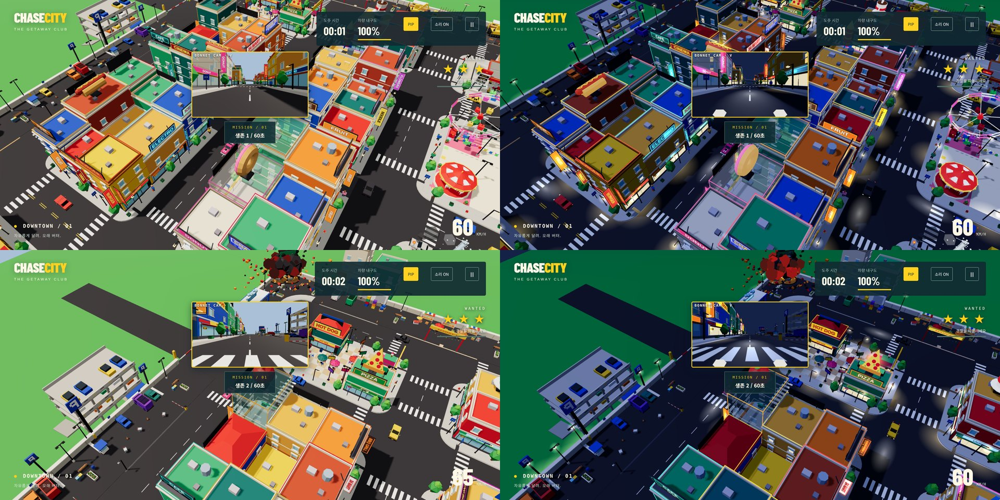
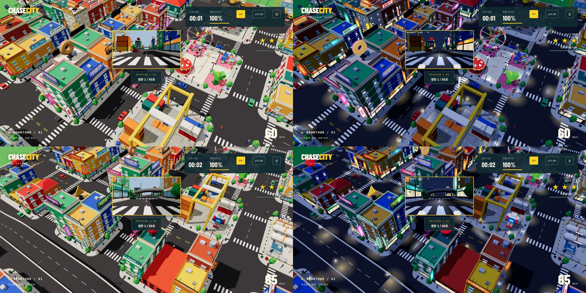
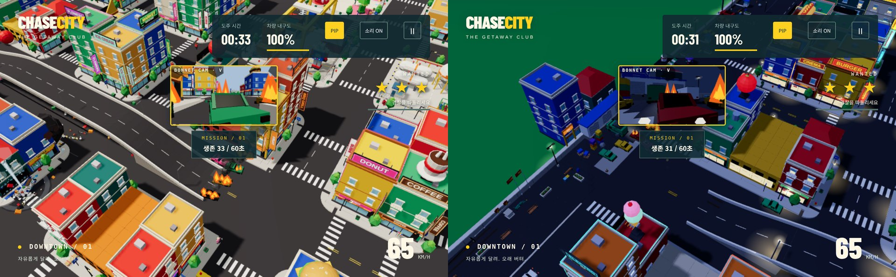
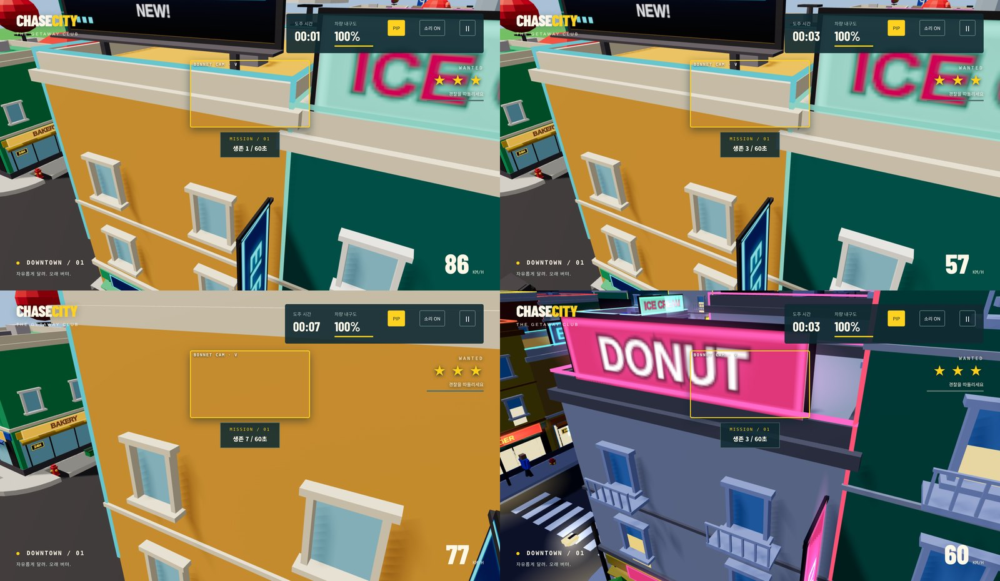
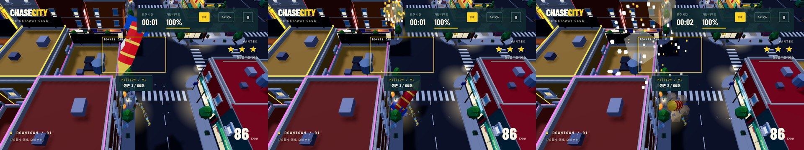
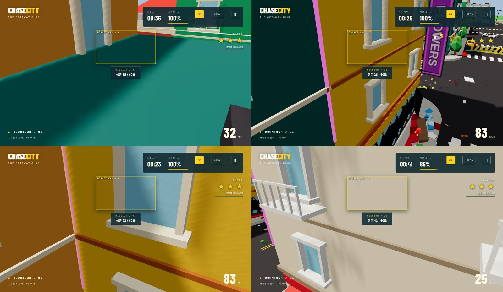
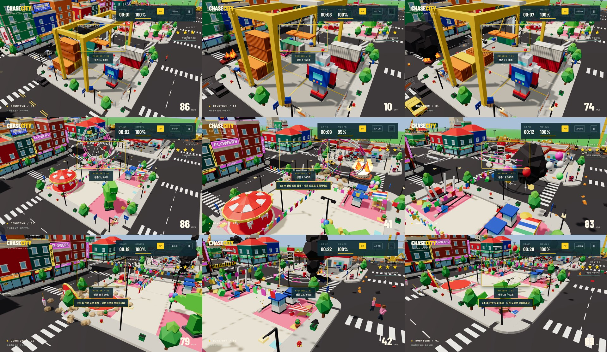

# CHASE CITY — 캐주얼 시각 재미·파괴 확장 보고서

- 브랜치: `claude/v20-mission-platform` (main 미병합)
- 작업 전 체크포인트: `6a818ba` (로컬 태그 `checkpoint-casual-fun`)
- 단계별 커밋:
  - `5e74318` 1단계(P0): 교량 파괴 난이도 하향 + 민간 차량 화재·손상 단계
  - `9129783` 2단계(P1): 상점 브랜드·간판, 대형 옥상 광고 조형물, 상점별 파괴 반응, 소화전, 불꽃놀이 가게
  - `8e7728f` 3단계(P2): 컨테이너 야적장, 소형 놀이공원, 대형 랜드마크 조형물, 차량 전복·연쇄 반응
  - `7681b5c` 네온 보강: 두 번째 세로 간판, 조형물 후광, 놀이공원 전구 줄
- 개발용 시드: **`?seed=3`** (개발 빌드). 이 시드에 모든 새 시설과 교량, 공사장 점프대가 있습니다.

## 1. 교량 파괴 기준 변경

| 항목 | 이전 | 변경 후 |
|---|---|---|
| 줄무늬(약한) 기둥 | 강한 충돌 2회 | 고속 충돌 1회(속도×무게 20 이상), 일반 충돌 2~3회 |
| 일반 기둥 | 파괴 불가 | 내구 150, 강한 충돌 약 2~4회 |
| 무거운 차 | 무게만큼 손상 | 동일(더 적은 횟수) |
| 경찰차 | 손상 | 손상(무게 1.2) |
| 폭발 | 약한 기둥만 | 모든 기둥(일반 기둥 60%), 연쇄 폭발로 붕괴 가능 |

- 피드백: 균열 두 단계, 콘크리트 조각·먼지, 맞을 때 흔들림, 많이 손상되면 기울어짐, 붕괴 굉음과 카메라 흔들림.
- 붕괴 시: 해당 구간만 떨어지고, 위 차량은 함께 떨어지며, 아래 차량은 부서지고 불이 붙습니다(일부는 잠시 뒤 폭발). 구간 옆 차량도 파편에 손상됩니다. 무너진 구간의 가로등은 꺼집니다.
- 잔해 블록은 차 위에 떨어지지 않도록 했습니다(갇힘 방지).
- 브라우저 측정(시드 1~6): 24 m/s 정면 충돌 **1회**로 6/6 기둥 파괴, 해당 구간만 붕괴, 경로에서 제외. 시드 2에서는 깔린 경찰차 폭발이 옆 기둥까지 무너뜨려 두 구간이 연쇄로 떨어졌습니다.

## 2. 민간 차량 손상·화재

| 단계 | 조건(체력) | 표현 |
|---|---|---|
| 경미 | 90 미만 | 충돌 스파크, 옅은 연기(6초) |
| 중간 | 60 미만 | 진한 연기, 가끔 스파크, 차체 색 어두워짐 |
| 심각 | 30 미만 | 엔진룸 불꽃(주황+노랑 2겹, 흔들림), 짙은 연기, 시간이 지나며 불이 차 전체로 번짐 |
| 치명(대파) | 0 | 큰 불꽃. 충돌이 셀수록 2.4~5.2초 뒤 폭발할 확률이 높음(약 22~65%) |
| 폭발 후 | | 공유 폭발 시스템으로 주변 차량·소품 피해, 절반은 뒤집혀 지붕으로 떨어짐, 그을린 잔해가 계속 연기를 냄 |

- 주행 중 차와 주차 차 모두 적용되고, 화면 밖으로 나갔다 돌아와도 그을린·뒤집힌 상태가 유지됩니다.
- 불타는 잔해를 다시 들이받거나 근처에서 폭발이 나면 곧바로(0.35~0.9초) 폭발합니다. 한 차는 한 번만 폭발합니다.
- 무작위 값은 도시의 시드 난수를 써서 재현됩니다.

## 3. 새 시설

- **상점 브랜드·간판(모든 도시)**: 상점 건물마다 브랜드(BURGER, PIZZA, HOT DOG, COFFEE, CAFE, DONUT, ICE CREAM, FRUIT, FLOWERS, 24 MART, MARKET, GAME, CINEMA 등 23종).
  - 상점 정면 간판, 창문 네온(OPEN/SALE 등), 세로 간판, 옥상 가장자리 큰 상호 간판, 지붕 네온 라인.
  - 옥상 광고판(일반·디지털 화면은 3초마다 광고가 바뀜).
- **대형 3D 광고 조형물**: 도시당 8~16개(햄버거, 도넛, 피자, 커피잔, 아이스크림, 핫도그, 사과, 불꽃놀이 로켓).
- **불꽃놀이 가게**: 도시당 1곳.
- **컨테이너 야적장**: 도시당 1블록. 2~3단 적재 컨테이너, 갠트리 크레인, 로봇 조형물, 펜스, 출입구 4곳.
- **소형 놀이공원**: 도시당 1블록. 대관람차, 회전목마, 공룡 조형물, 매표소, 풍선 카트, 음식 노점, 깃발·전구 줄, 출입구 4곳.
- 기존 시설은 모두 유지했고, 새 시설은 블록 2개를 더 쓰는 방식입니다(도시당 건물 수는 약 100개에서 75~85개로 줄었습니다).

## 4. 시설별 파괴 동작

- **광고 조형물**: 상점을 세게 들이받거나(16 m/s 이상 확정, 11 m/s 이상 확률) 근처 폭발 시 떨어집니다.
  - 잠시 빛나다가 꺼지고, 튕기며 굴러갑니다(도넛은 바퀴처럼 서서 굴러가다 멈추면 눕습니다).
  - 차량(손상·화재·전복), 소품, 상점 유리, 교량 기둥과 부딪힙니다.
  - 멈춘 뒤에는 고체가 아니라 차가 밀고 지나갑니다.
  - 측정: 굴러간 거리 7~20 m.
- **상점별 반응**(기존 유리·간판·차양 파손에 추가):
  - 과일: 큰 과일이 굴러가고 상자가 부서짐.
  - 꽃집: 꽃·꽃잎이 천천히 흩날리고 화분이 깨짐.
  - 카페: 컵·접시·의자·파라솔·메뉴판.
  - 시장: 바구니·상자·과일·노점 차양과 기둥.
  - 식당: 의자·테이블·음식 상자·접시, 가끔 화재.
  - 측정 파편 수: 과일 59, 꽃 70, 카페 42, 시장 24~36, 식당 15~17.
- **네온 파괴**: 상점이 부서지면 그 간판과 창 네온, 진열창 불빛이 꺼집니다. 같은 건물의 다른 간판은 깜빡이며 스파크를 튀기고, 일부는 꺼집니다. 디지털 화면은 색이 깨지는 글리치를 보입니다. 폭발도 간판을 깜빡이거나 꺼지게 합니다.
- **소화전**: 물기둥이 처음 1.2초 동안 더 높이 솟고, 이후 8.4 m로 유지되며 물안개가 생깁니다. 젖은 노면이 30초에 걸쳐 도로로 번지고, 물 소리가 납니다.
- **불꽃놀이 가게**:
  - 로켓 16발이 차례로 발사되고 색색의 폭죽과 색 연기가 나며, 옥상 로켓 조형물도 떨어집니다.
  - 일부 로켓은 도로를 가로질러 지면에서 터지는 작은 폭발이 됩니다(최대 3회, 연쇄 가능).
  - 측정: 로켓 16, 폭죽 16, 지면 폭발 3.
- **컨테이너**:
  - 밀면 미끄러지고, 10 m/s 이상이면 위 컨테이너가 옆으로 떨어지며 아래 차를 깔아 뭉갭니다.
  - 16 m/s 이상이면 옆 적재까지 도미노처럼 무너지고, 15 m/s 이상이면 단독 컨테이너가 옆으로 넘어집니다. 폭발도 같은 효과를 냅니다.
  - 모든 컨테이너는 밀 수 있어 갇히지 않습니다. 측정: 1회 충돌로 4개 전도.
- **대관람차**: 받침대를 11 m/s 이상으로 치거나 폭발이 나면 바퀴가 빠져 도로로 굴러가고(측정 17~19 m), 곤돌라 10개가 날아갑니다.
- **회전목마**: 지붕과 말 6마리가 날아갑니다.
- **풍선**: 하늘로 날아가거나 일부는 터집니다.
- **랜드마크(공룡·로봇)**: 맞으면 기울고 금이 가며 윗부분이 먼저 떨어지고, 결국 큰 조각들로 부서져 굴러가 차와 부딪힙니다. 측정: 22 m/s 2회 충돌로 파괴.

## 5. 충돌·연쇄 반응 개선

- 강한 폭발 근처나 큰 물체에 맞은 민간 차는 공중으로 뜨며 한 바퀴 구릅니다. 대파된 차는 지붕으로 떨어져 그대로 남습니다.
- 폭발한 차도 튀어 오릅니다.
- 큰 착지(조형물·컨테이너·랜드마크), 기둥 붕괴, 교량 착지에서 카메라가 흔들립니다. 슬로모션은 넣지 않았습니다(조작감 유지).
- 연쇄 예: 조형물 → 차 화재 → 폭발 → 옆 차 폭발 / 컨테이너 도미노 / 불꽃놀이 지면 폭발 → 주변 차 / 경찰차 폭발 → 교량 기둥 → 다음 구간.

## 6. 스크린샷

| | |
|---|---|
| 실제 게임 화면 낮·밤(같은 도시, 같은 간판) |  |
| 놀이공원·야적장 낮·밤 |  |
| 민간 차량 화재(낮·밤) |  |
| 광고 조형물 낙하·굴러감 |  |
| 불꽃놀이 가게(밤) |  |
| 상점별 파괴 반응 |  |
| 야적장·놀이공원·공룡 파괴 |  |

## 7. 회귀 테스트

- `npm test`: **210/210 통과**(새 테스트 포함). 새 테스트는 20개 시드에서 다음을 확인합니다:
  - 브랜드, 불꽃놀이 가게 1곳, 조형물 8개 이상, 광고판
  - 결정론
  - 차량 손상 단계와 지연 폭발(한 번만)
  - 야적장·놀이공원 존재와 4방향 관통 통로
  - 기둥 파괴 횟수
- 기존 건물 끼임 스윕 테스트가 붕괴 잔해가 차 위에 생기는 경우를 찾아내 수정했습니다.
- 브라우저 파괴 회귀(시드 1~6, 실제 게임 루프): 상점 파손, 가스 저장소 탱크 3/3 파열, 주차장 연쇄 폭발, 파괴 유지, 콘솔 오류 0이 모두 통과했습니다.
  - 주유소 펌프는 시드 2~6에서 자동 카운터로 통과했습니다.
  - 시드 1은 카운터가 0이었지만, 스크린샷으로 펌프 폭발과 캐노피 붕괴를 확인했습니다(계측 누락).
- 교량(시드 1~6): 6/6 한 번에 파괴, 6/6 해당 구간만 붕괴. 붕괴 후 같은 선으로 다시 통과하는 시험은 4/6이 통과했고, 2개 시드는 남은 기둥에 막혀 방향을 틀었습니다(갇힘 없음, 속도 17~23 m/s 유지).
- 장시간 주행(Node 시뮬레이션, 8시드 × 2 주행 = 16회·24분):
  - 체포 29회, 4초 이상 정체 50회(최장 11.1초), 오체포 1회.
  - 직전 빌드는 체포 30회, 정체 58회(최장 10.8초), 오체포 3회였습니다.

## 8. 성능

Chromium 소프트웨어 렌더러(SwiftShader), iPhone 13 에뮬레이션과 1280×720, 시드 3에서 측정했습니다. 빌드 간 비교용이며, 실기기에서 측정하지 않았습니다.

| 프레임 시간 중앙값 (휴대폰 에뮬레이션) | 작업 전 6a818ba | 이번 빌드 |
|---|---|---|
| 주행(낮) | 290 ms | 304 ms |
| 경찰차 4대 폭발 | 251 ms | 263 ms |
| 경찰차 6대 + 상점 8곳 | 244 ms | 280 ms |
| 혼란(차량 6대 화재 + 조형물 2개 + 불꽃놀이) | 275 ms* | 311 ms |
| 주행(밤) | 285 ms | 305 ms |

\* 작업 전 빌드에는 조형물·불꽃놀이가 없어 차량 화재만 같은 조건입니다.

- 드로우콜: 휴대폰 주행 기준 90 → 110. 간판 전체가 4번, 컨테이너는 1번(인스턴스), 조형물은 개당 1번입니다.
- 휴대폰 에뮬레이션에서는 약 5~15%, PC 해상도에서는 약 13~25% 느려졌습니다.

## 9. 남은 문제

- 실기기 성능을 측정하지 않았습니다.
- 건물이 카메라 앞에서 반투명해질 때 그 건물의 간판·조형물은 불투명하게 남습니다.
- 야적장·놀이공원이 블록 2개를 쓰므로 도시당 상점 건물이 줄었습니다.
- 교량 붕괴 후 같은 선으로 재통과할 때 남은 기둥에 막히는 경우가 있습니다(갇히지는 않음).
- 이번 빌드는 아직 **플레이어 차량 내구도 게이지와 '내구도 소진' 게임 오버가 남아 있습니다**. 다음 작업(헬리콥터·코인)에서 비활성화합니다.

## 10. 미리보기

- 게임: https://claude.ai/artifact/RDq46DwiMjLpsBFeNn7SPL (버전 16, `7681b5c` 빌드). 비공개이므로 공유 메뉴에서 공유해야 다른 사람이 열 수 있습니다.
