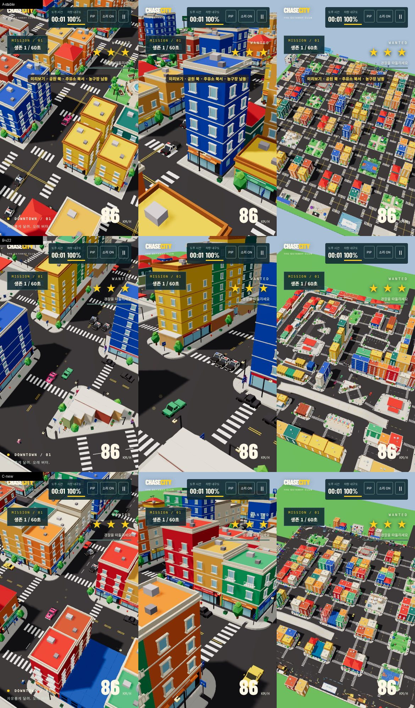
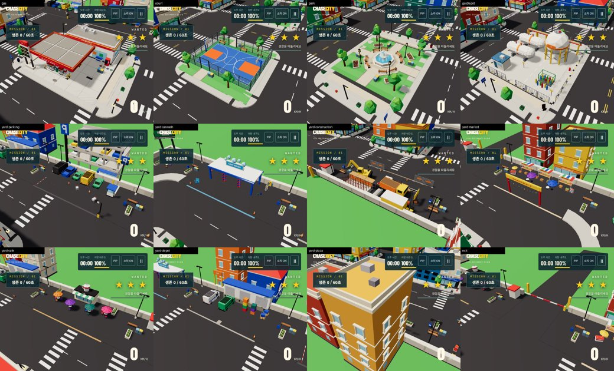
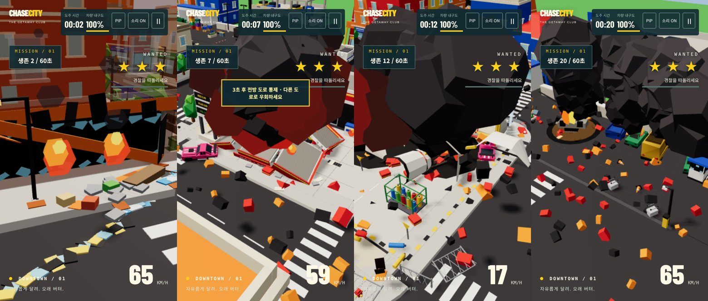

# CHASE CITY — 핵심 게임플레이 복구 · 절차적 맵 재구성 보고서

- 브랜치: `claude/v20-mission-platform` (main 미병합)
- 커밋: `ad92b92`(모듈 도시 + 시설·파괴 복구) → `f7e9bd2`(잔해 밀어내기) → 이 문서 커밋
- 비교 기준(마지막 안정판): `6bf8cb3`. 랜덤 맵 개편 직전 커밋입니다. 시설과 파괴가 모두 있던 화면은 이 커밋의 `locations.html`(장소 프리뷰)입니다.
- 회귀판: `56c579d` (V2.2, 직전 배포)
- 세 빌드를 각각 별도 `git worktree` + vite 서버(포트 5176/5177/5175)에서 실행하고, 같은 카메라로 비교했습니다.

## 1. 회귀 원인

코드를 비교해 보니, 파괴와 시설이 "사라진" 것이 아니라 **랜덤 맵에 연결된 적이 없었습니다.**

| 항목 | 안정판(6bf8cb3) | V2.1~V2.2 | 원인 |
|---|---|---|---|
| 주유소 폭발·캐노피 붕괴, 가스 저장소 연쇄 폭발, 분수 공원, 농구장, 야드(주차·세차·공사·시장·카페·창고·광장) | `preview/locations/runtime.js` (LocationsRuntime) | 없음 | 생성 도시(`citygen.js`)가 이 런타임을 거치지 않고, 단순 대체물(빨간 캐노피 상자 주유소, 장식 가판대)만 그림 |
| 1층 상점 파괴(유리·차양·간판·화재) | `storefronts.js` | 없음 | 같은 런타임 소속. 건물이 모두 7×7 m라는 전제(면 3.5 m) |
| 주차·작업 차량 파손·폭발 | `vehicles.js` (VehicleSystem) | 없음 | 같은 런타임 소속 |
| 시설 위치 | `GAS/COURT/PARK/GASDEPOT` 상수(다운타운 고정 좌표) | — | 모듈이 고정 좌표에 묶여 있어 랜덤 배치가 불가능 |
| 건물 사이 홈(첨부 23-1) | 7×7 건물 4채 + 틈 메움 | 2 m 래스터 단위로 건물을 채움 | 깊이가 제각각인 계단식 전면, 좁은 틈 |
| 외곽 투명 벽 | — | 도로가 도시 끝(±108)까지 이어지고, 차는 ±106에서 보이지 않는 경계에 막힘 | 경계가 보이지 않음 |
| 상점 충돌 시 조명 깜빡임 | — | 파괴 시스템이 없어, 충돌이 건물 가림 투명화(occlusion)만 일으킴 | 파괴 연출 부재 |

## 2. 접근 방식

기존 랜덤 생성기(자유 격자·대각선·곡선 도로·래스터 건물 채움)는 시설 모듈과 구조적으로 맞지 않았습니다. 그래서 안정판의 모듈을 **그대로** 쓰고, 그 위에 생성기를 새로 세웠습니다. 전체 되돌리기는 하지 않았고, V2.x의 개선 사항은 그대로 둡니다: 도로 그래프 내비게이션, 고가도로, 인도·횡단보도, 바리케이드, 미션, 난이도.

- 모든 모듈의 위치를 도시마다 바꿀 수 있게 했습니다(`layout-consts.js`의 `setLocations`).
- `LocationsRuntime`이 본 게임에서 돌아가고, 도시가 바뀔 때마다 다시 만들어집니다(그룹 단위로 해제: `dispose`).
- 상점 파괴를 모든 크기의 건물 면에 맞게 일반화했습니다(면 폭·깊이에 맞춰 늘이고 이동).

## 3. 복구된 시설 전체 목록 (안정판 기준, 모든 도시에 존재 — 검증 항목)

| 시설 | 상호작용 / 파괴 / 폭발 | 배치 |
|---|---|---|
| 주유소 | 펌프 섬 충돌 → 폭발(연쇄), 캐노피 붕괴, 매점 유리 파손, 화재 | 블록 1개(모듈 통째) |
| 가스 저장소(산업 시설) | 탱크 3기 파열 → 최대 규모 연쇄 폭발, 파편, 울타리·가스통 비산 | 블록 1개 |
| 분수 공원 | 분수 파손 → 물기둥·물결, 벤치·가로등 파손 | 블록 1개 |
| 농구장 | 펜스 패널·골대·공·벤치 | 블록 1개 |
| 테마 공원 2곳(기념·가족·예술·시장 테마) | 동상, 키오스크, 아이스크림 트럭, 조각, 카페 세트 | 블록 2개 |
| 주차장 | 주차 차량(파손 단계·폭발·연쇄), 차단기, CCTV, 부스, 카트 | 외곽 야드 |
| 세차장 | 회전 브러시(거품·물 폭발), 간판, 선반 | 외곽 야드 |
| 공사장 | 굴착기·덤프트럭(무거운 차량), 비계 순차 붕괴, 파이프, 벽돌, 조명탑 | 외곽 야드 |
| 시장 | MARKET 아치 전도, 노점 붕괴, 과일 상자 파열, 파라솔 | 외곽 야드 + 상점가 |
| 카페 | 테이블·의자·파라솔 비산 | 외곽 야드 |
| 창고(DEPOT) | DEPOT 갠트리 전도, 화물 더미 연쇄 붕괴, 밴 | 외곽 야드 |
| 광장 | 동상 받침, 깃대, 벤치, 화분 | 외곽 야드 |
| 모서리 광고탑 | 광고판, 벤치 | 도시 네 모서리 |
| 상점가 1층 | 모든 거리 면에서 유리·차양·간판 파손, 일부 화재, 그을음 | 모든 건물 블록 |
| 거리 소품 | 가로등·쓰레기통·나무·표지판·소화전(물기둥) | 도시당 약 550개 |
| 가판 소품 | 입간판·진열대·화분·신문함 | 상점 앞·교차로 모서리 |
| 주차 차량(도로변) | 파손·폭발 | 넓은 도로 |
| 외곽 경계 건물 | 주차 빌딩·세차 홀·크레인 골조·상가(배경) | 야드 뒤 |

도시당 상호작용 오브젝트(소품 + 아이템 + 비산 소품 + 차량 + 상점 면)는 안정판의 90% 이상입니다(테스트로 강제). 차량 수는 안정판의 80% 이상입니다.

## 4. 복구된 파괴·폭발 시스템

모두 안정판 코드를 그대로 씁니다(대체물이 아닙니다).
- 통합 폭발 시스템(`blast.js`): 경찰차, 주차 차량, 펌프, 탱크가 연쇄로 폭발합니다.
- 화염·연기, 파편, 음향, 카메라 흔들림.
- 파괴 상태는 재시작 전까지 유지됩니다. 파편은 땅에 떨어지면 정지 상태로 바뀌어 더 이상 계산하지 않습니다.

## 5. 절차적 맵 구조 변경 (하이브리드: 검증된 모듈 + 무작위 변형)

- **도로**: 5×5 직선 격자(블록 33~40 m)와 링 도로, 각 방향 넓은 대로 1개.
  - 블록 1~3쌍을 합쳐 긴 블록을 만들고, T자 교차로와 원래 도로 자리의 직선 골목(6 m)을 둡니다.
  - 고가도로는 교차로 2개를 넘는 직선형 또는 대로 교차점에서 꺾이는 곡선형입니다(40개 시드 중 36개에 존재, 15개가 곡선형).
- **무작위 요소**: 모듈 배치, 블록 크기, 블록 합침, 골목 위치, 건물 조합·높이·색, 야드 종류 순서, 고가도로 위치·형태, 소품 배치.
- **검증**(`validateCity`, 실패 시 다음 파생 시드로 재생성):
  - 도로 연결성, 차량 통과 폭, 골목 양끝 개방, 출발·출구 확보, 닫힌 공간.
  - 이번에 추가: 필수 시설 누락, 파괴 콘텐츠 부족, 건물 사이 함정 틈, 링 밖으로 나가는 도로.
  - 시드는 결정적입니다(`?seed=N`으로 재현).
- 곡선 일반 도로는 이번 단계에서 뺐습니다. 시설 모듈은 직사각형 블록이 필요하기 때문입니다.

## 6. 건물 배치·충돌 수정

- 건물 블록은 거리마다 **한 줄로 이어진 전면**입니다. 폭 6.5~10 m의 건물을 틈 없이 붙였습니다.
- 큰 블록의 안뜰은 낮은 뒷건물로 채웠습니다(밀려 들어갈 공간이 없음).
- 홈이나 틈이 생기면 생성 단계에서 거부합니다(검증 + 테스트).
- 지름길: 일부 블록에 폭 10~14 m의 낮은 홀이 블록을 관통합니다. 전속력으로 들이받으면 통로가 뚫리고, 나머지는 남습니다.
- 잔해 함정 방지: 플레이어 차가 경찰 잔해를 1.2초 이상 밀고 있으면 잔해가 밀려납니다. 단단한 물체 쪽으로는 밀리지 않고, 체포 카운트다운 중에는 밀리지 않습니다. 정당한 경찰 포위는 그대로 유지됩니다.
- 건물 높이·디테일은 다운타운과 같은 범위(5~17 m)와 같은 `buildingGroup` 모델(창, 발코니, 상점 전면, 지붕)입니다.

## 7. 맵 경계 수정

- 일반 도로는 링 도로에서 끝납니다. 링 밖으로 이어지는 가짜 도로 입구는 없습니다.
- 도시 가장자리에 **보이는 낮은 벽**(충돌 있음)을 세웠습니다. 벽이 끊기는 곳은 출구 4곳뿐입니다.
- 출구에는 차단기와 경비 부스가 있습니다. 차단기는 탈출 단계에서 해당 출구가 열릴 때만 올라갑니다.
- 링 밖 띠에는 야드 시설이 있고, 그 뒤 도시 밖에 배경 건물이 섭니다.
- 플레이어와 경찰은 같은 고체 목록과 같은 도로 그래프를 씁니다.

## 8. 비교 스크린샷 (같은 시드 3·같은 카메라: 추격 / 거리 / 전경)

A = 안정판 6bf8cb3(`locations.html`), B = V2.2(회귀), C = 이번 복구

시설(이번 빌드, 시드 3)

파괴(브라우저 실제 게임 루프: 상점 / 주유소 / 저장소 / 주차 연쇄)

## 9. 테스트 결과

- 자동 테스트: `npm test` **199/199 통과**.
  - 생성기 60개 시드: 검증 통과, 모든 시설·야드 종류 존재.
  - 고가도로 직선·곡선, 함정 스윕, 지름길, 내용량(안정판 대비), 건물 틈, 경계 벽, 횡단보도, 인도, 바리케이드, 질량.
- **실제 브라우저 게임플레이 20개 시드**(`index.html`, 실제 게임 루프, Chromium):
  - 시드마다 다음을 확인했습니다.
    - 시설 목록
    - 상점 정면 충돌 → 파손
    - 주유소 펌프 충돌 → 폭발(두 섬 연쇄)
    - 저장소 탱크 충돌 → 3기 연쇄 파열
    - 주차 차량 충돌 → 파손
    - 주차장 옆 경찰차 폭발 → 주차 차량 연쇄 폭발
    - 12초 주행 후 파괴 상태 유지
  - 결과는 아래 표와 같습니다.

| 시드 | 야드 종류 | 상점 면 | 차량 | 상점 파손 | 펌프 폭발 | 탱크 파열 | 충돌 파손 차량 | 연쇄 폭발 차량 | 폭발 수 | 12초 후 유지 |
|---|---|---|---|---|---|---|---|---|---|---|
| 1 | 8/8 | 168 | 39 | 1 | 2/2 | 3/3 | 5 | 5 | 12 | 예 |
| 2 | 8/8 | 172 | 39 | 1 | 2/2 | 3/3 | 3 | 3 | 10 | 예 |
| 3 | 8/8 | 178 | 35 | 1 | 2/2 | 3/3 | 1 | 5 | 13 | 예 |
| 4 | 8/8 | 170 | 39 | 1 | 2/2 | 3/3 | 5 | 5 | 12 | 예 |
| 5 | 8/8 | 174 | 37 | 1 | 2/2 | 3/3 | 5 | 5 | 12 | 예 |
| 6 | 8/8 | 160 | 39 | 1 | 2/2 | 3/3 | 5 | 5 | 13 | 예 |
| 7 | 8/8 | 166 | 37 | 1 | 2/2 | 3/3 | 4 | 4 | 12 | 예 |
| 8 | 8/8 | 174 | 34 | 1 | 2/2 | 3/3 | 1 | 3 | 10 | 예 |
| 9 | 8/8 | 172 | 40 | 1 | 2/2 | 3/3 | 4 | 4 | 12 | 예 |
| 10 | 8/8 | 170 | 39 | 1 | 2/2 | 3/3 | 2 | 4 | 11 | 예 |
| 11 | 8/8 | 169 | 40 | 1 | 2/2 | 3/3 | 5 | 5 | 12 | 예 |
| 12 | 8/8 | 172 | 39 | 1 | 2/2 | 3/3 | 4 | 4 | 12 | 예 |
| 13 | 8/8 | 166 | 38 | 1 | 2/2 | 3/3 | 5 | 5 | 12 | 예 |
| 14 | 8/8 | 166 | 35 | 1 | 2/2 | 3/3 | 2 | 4 | 11 | 예 |
| 15 | 8/8 | 164 | 36 | 1 | 2/2 | 3/3 | 4 | 4 | 11 | 예 |
| 16 | 8/8 | 170 | 38 | 1 | 2/2 | 3/3 | 4 | 4 | 11 | 예 |
| 17 | 8/8 | 170 | 34 | 1 | 2/2 | 3/3 | 3 | 3 | 10 | 예 |
| 18 | 8/8 | 186 | 41 | 1 | 2/2 | 3/3 | 1 | 5 | 12 | 예 |
| 19 | 8/8 | 172 | 38 | 1 | 2/2 | 3/3 | 0 | 5 | 12 | 예 |
| 20 | 8/8 | 171 | 39 | 1 | 2/2 | 3/3 | 5 | 5 | 12 | 예 |

20개 시드 모두: 콘솔 오류 0, 모든 시설 존재, 상점·펌프·탱크 파괴 성공, 연쇄 폭발 성공, 파괴 상태 유지. ("충돌 파손 차량"이 1인 시드는 첫 충돌로 1대만 파손된 경우이고, 0인 시드 19는 조준한 차량을 비껴간 경우입니다.)

- 경찰·함정 장기 주행(Node 시뮬레이션, 생성 도시 16회, 24분):
  - 체포 33회, 오체포 1회(포위 판정 프로브의 한계).
  - 4초 이상 정체 45회, **최장 7.5초**(V2.2는 9초). 영구 갇힘 없음.
- 타깃 헌트: 16회 중 고착 0회. 미션 스모크(생존·택배·타깃 헌트): 벽 속 끼임 0.

## 10. 성능 (측정 환경과 한계)

- 환경: 클라우드 컨테이너, Chromium + **SwiftShader 소프트웨어 렌더러**, iPhone 13 에뮬레이션(390×664, DPR 3)과 PC(1280×720).
- **실제 iOS/Android 기기에서는 테스트하지 않았습니다.** 수치는 빌드 간 상대 비교용입니다. 30/60 FPS 목표 충족 여부는 실기기에서 재야 합니다.

| 빌드(시드 3, 폰 에뮬) | 주행 중앙값 | 폭발 중 중앙값 | 드로우콜 | 삼각형 |
|---|---|---|---|---|
| 안정판 6bf8cb3 | 221 ms | 231 ms | 94 | 109k |
| V2.2 | 216 ms | 255 ms | 71 | 102k |
| 이번 복구 | 225 ms | 232 ms | 92 | 116k |

CPU 시간(프레임당, 폰 에뮬): 시뮬레이션 5.0 ms(안정판 3.1 ms), 시설 런타임 1.0 ms.

이번에 적용한 최적화:
- 야드 36→28곳(사이에 가벼운 소품), 경계 배경 건물의 그림자 제거, 건물 높이를 다운타운 범위로.
- 시설 파괴 조각은 배치 메시(한 번의 드로우콜)와 인스턴싱으로 그립니다.
- 정지한 파편은 계산하지 않습니다.

## 11. 남은 문제

- 실기기 성능 미측정.
- 일반 도로는 직선 격자입니다(블록 크기·합침·골목·고가도로·모듈 배치로 변화를 줌). 곡선 일반 도로는 직사각형 모듈과 맞지 않아 이번 단계에서 뺐습니다.
- 주유소·저장소·농구장·분수 공원은 도시마다 1곳씩입니다(런타임이 한 개씩을 전제로 설계됨).
- 장기 주행에서 4~7초 정체(경찰 포위·잔해 근처)가 남아 있고, 오체포 1회가 있었습니다.
- 랜덤 맵에서는 바리케이드 설치 조건이 엄격해서 로드블록이 드뭅니다.
- 주차 차량 단독 충돌 테스트에서 일부 시드는 조준한 차량을 비껴 1대만 파손됐습니다(연쇄 폭발 테스트는 모든 시드에서 성공).

## 12. 미리보기

- 플레이 가능한 최신 미리보기(이번 빌드): https://claude.ai/artifact/RDq46DwiMjLpsBFeNn7SPL
- 안정판 다운타운 참고 페이지(같은 빌드의 장소 프리뷰): https://claude.ai/artifact/DjZT1WSyvKA3kFqCdiqcx8
