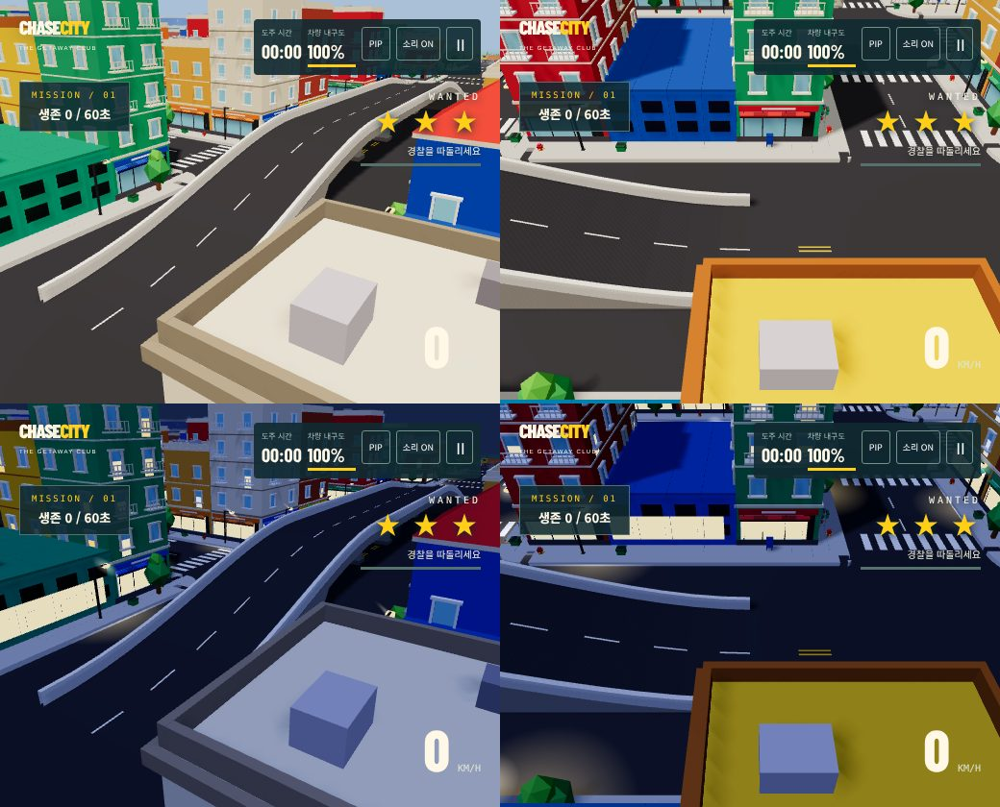
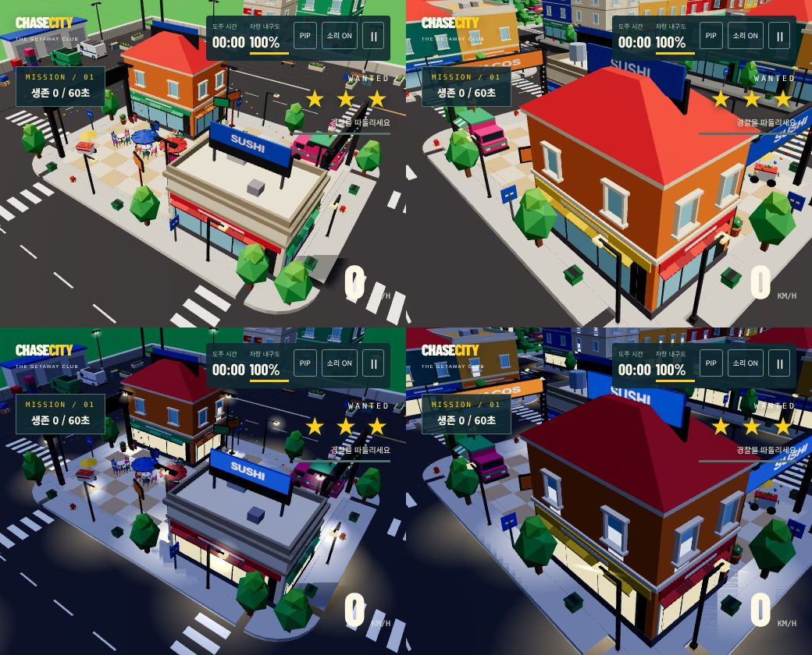
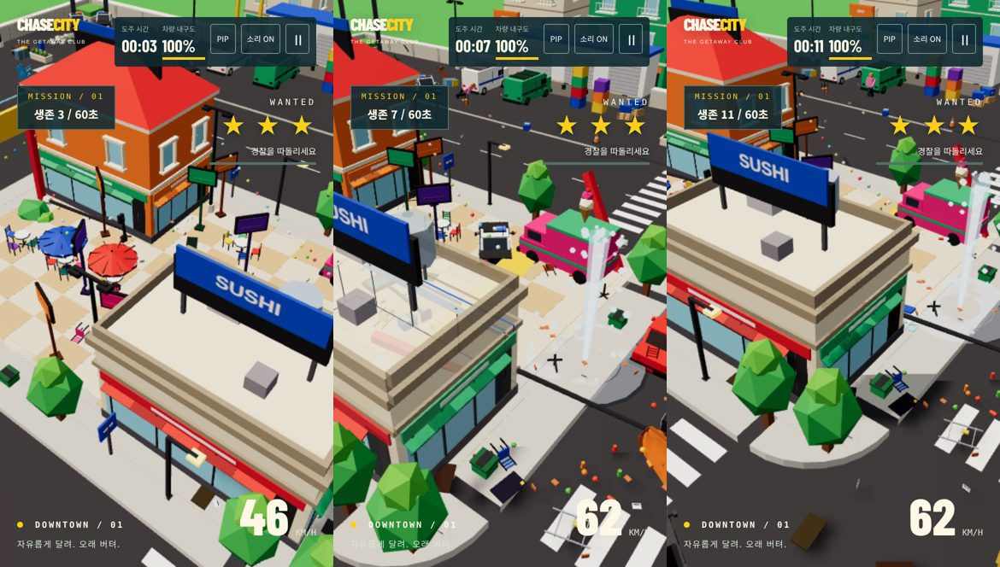
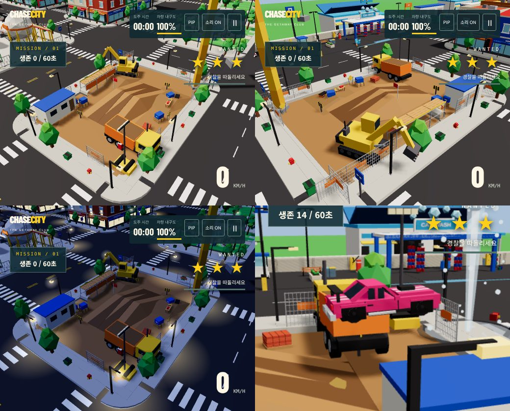
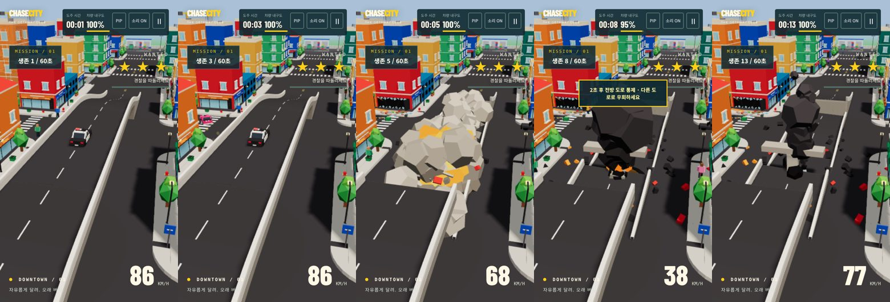
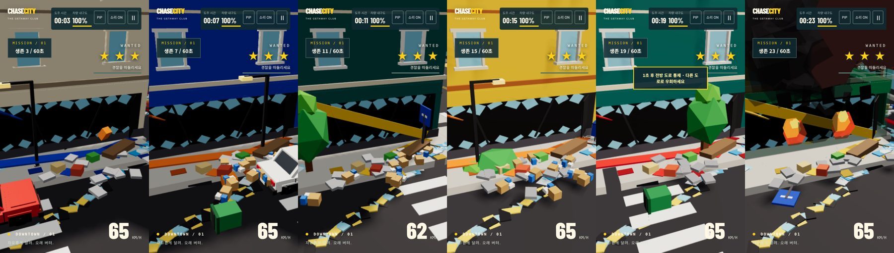

# CHASE CITY — 도시 파괴·액션 콘텐츠 확장 보고서

- 브랜치: `claude/v20-mission-platform` (main 미병합)
- 작업 전 체크포인트: `a59f5c1` (로컬 태그 `checkpoint-core-recovery`)
- 단계별 커밋:
  - `feb1d76` 1단계: 고가도로 노면
  - `f07ae63` 2단계: 상점 파괴
  - `b24884d` 3단계: 레스토랑 광장
  - `c0fa226` 4단계: 공사장·점프
  - `f2cb43b` 5단계: 교량 붕괴
  - 테스트 커밋
  - `55d94a6` 잔해 갇힘·프레임 급락 수정
  - 이 문서 커밋
- 개발용 시드: **`?seed=3`**. 이 시드에는 레스토랑 광장, 대형 공사장(점프대), 고가도로(약한 기둥 포함)가 모두 있습니다. 상점 파괴는 모든 도시에 있습니다.

## 1. 완료한 기능

1. **고가도로 노면**: 상판과 진입·진출 램프를 일반 도로와 같은 아스팔트 색과 재질로 바꿨습니다. 차선도 일반 도로와 같은 흰 점선(2 m 칠하고 2 m 띄움)입니다. 낮과 밤 모두 일반 도로와 같게 보이고, 콘크리트 측벽·난간·기둥은 구분됩니다.
2. **상점 1층 파괴·화재·폭발**: 상점마다 유형이 있고, 충돌 세기와 제한된 무작위 값으로 반응이 정해집니다.
3. **레스토랑 광장**: 모든 도시에 새 블록 1곳이 생깁니다. 식당, 광고판, 넘어지는 대형 광고 아치, 식사 테이블, 네온이 있습니다.
4. **대형 공사장 + 자동 점프**: 모든 도시에 1곳 있고, 흙 점프대에서 버튼 없이 점프합니다. 경찰과 타깃 차량도 점프합니다.
5. **교량 기둥 파괴와 부분 붕괴**: 약한 기둥이 무너지면 그 기둥이 받치던 구간만 떨어집니다.

기존 시설은 모두 유지했습니다(주유소, 가스 저장소, 농구장, 세차장, 기존 공사장 야드, 분수 공원, 시장, 주차장, 상가, 주차 차량, 거리 소품). 기존 시설 대신 새 시설을 넣은 것이 아니라, 블록 2개를 새로 더한 것입니다.

## 2. 새 시설 스크린샷

| | |
|---|---|
| 고가도로 노면(낮/밤) |  |
| 레스토랑 광장(낮/밤) |  |
| 광장 파괴(관통/아치 전도/식당) |  |
| 대형 공사장 + 점프(공중) |  |
| 교량 붕괴 순서 |  |
| 상점 유형별 파괴 |  |

## 3. 상점 파괴·폭발 동작

모든 상점은 공통으로 다음이 부서집니다: 진열창 유리(파편 비산), 창틀·문, 차양, 간판. 파손된 내부가 드러나고, 유리 깨지는 소리가 납니다. 추가 반응은 상점 유형, 충돌 세기, 무작위 값으로 정해집니다.

| 유형 | 반응 |
|---|---|
| plain | 유리·창틀만 깨짐(가끔 물건이 쏟아짐) |
| goods | 상품(상자·캔·포장)이 인도로 쏟아짐 |
| electric | 전선 스파크(약 3초, 소리), 상품 |
| diner | 강한 충돌(12 m/s 이상) 때 주방 화재. 계속 타고, 연기는 점점 옅어짐 |
| bottles | 강한 충돌 때 가스통 소폭발(세기 0.9). 주변 차량·소품까지 연쇄 |
| major | 일부 대형 상가(전면 약 14곳 중 1곳). 큰 폭발(세기 2.2)과 함께 같은 건물의 다른 전면도 터짐 |

- 주변 폭발에 휘말려도 상점이 깨집니다.
- 깨진 전면은 재시작 전까지 복구되지 않습니다.
- 파편은 땅에 닿으면 정지 상태로 바뀝니다. 종류마다 최대 160개를 유지하고, 넘치면 가장 오래된 파편을 재사용합니다.
- 위층은 무너지지 않습니다.

## 4. 차량 점프 동작

- 흙 둔덕은 높이장입니다. 경사를 오르면 차가 위로 속도를 얻고, 꼭대기를 넘어 지면이 관성 궤적보다 낮아지면 공중에 뜹니다. 점프 버튼은 없습니다.
- 측정값(시드 3, 메인 점프대 높이 1.7 m, 길이 12.4 m, 양방향):

| 진입 속도 | 체공 시간 | 비행 거리 | 최고 높이 |
|---|---|---|---|
| 16 m/s | 0.7 s | 15.9 m | 2.4 m |
| 22 m/s | 0.8 s | 18.9 m | 2.6 m |
| 28 m/s | 0.8 s | 19.9 m | 2.8 m |
| 경찰차 24 m/s | 0.6 s | 12.4 m | 1.5 m |

- 차체는 이륙할 때 앞이 들리고 착지할 때 앞이 숙여집니다.
- 착지하면 흙먼지와 둔탁한 소리가 나고, 속도를 약간만 잃은 채 계속 달립니다. 좌우 조향은 그대로입니다.
- 무거운 차는 조금 덜 높이 뜹니다.
- 공중에 있는 동안 지면의 울타리나 소품과는 부딪히지 않지만, 건물과는 충돌합니다(건물을 뚫고 지나가지 않음).
- 점프대 진입·착지 통로(폭 8.4 m)에는 아무것도 두지 않았습니다(테스트로 강제).

## 5. 교량 붕괴 동작

- 기둥 두 개 중 하나가 노란·검은 줄무늬가 있는 약한 기둥입니다.
  - 충돌 속도와 차량 무게만큼 손상이 쌓입니다. 무거운 차일수록 적은 횟수로 부서집니다.
  - 폭발도 기둥을 손상시킵니다.
  - 균열은 두 단계로 보이고, 맞을 때마다 콘크리트 조각과 먼지가 튑니다.
  - 일반 기둥은 부서지지 않습니다. 그래서 고가도로 전체가 한꺼번에 무너지는 일은 없습니다.
- 약한 기둥이 무너지면 그 기둥이 받치던 구간만 떨어집니다(앞 기둥부터 뒤 기둥까지, 또는 램프 둑 끝까지).
  - 상판은 기둥 위치에서 나뉜 조각 모델입니다. 해당 조각만 떨어지면서 기울고 땅에 놓입니다.
  - 그 구간 위에 있던 차는 함께 떨어집니다. 끊어진 끝으로 달려온 차는 아래 도로로 떨어집니다.
  - 착지할 때 아래에 있던 경찰차와 일반 차는 부서지고, 플레이어는 피해를 입고 옆으로 밀려납니다.
  - 붕괴 연출은 불덩이가 아니라 콘크리트 먼지 구름과 굉음입니다. 길이 보이도록 먼지 양과 지속 시간을 줄였습니다.
- **충돌·내비게이션 갱신**:
  - 떨어진 구간은 더 이상 상판이 아닙니다(그 구간 위 차는 떨어짐).
  - 고가도로는 경로망에서 빠지므로, 경찰·일반 차량·타깃은 지상 도로로 우회합니다.
  - 남는 고체는 구간 양 끝 측면의 잔해 4개뿐이고, 대로 차선은 그대로 달릴 수 있습니다.
  - 도시 연결성은 고가도로 없이도 유지됩니다(생성 단계 검증). 따라서 미션 목표에는 항상 지상 경로가 있습니다.
- 붕괴는 재시작 전까지 유지됩니다.

## 6. 절차적 맵 통합

- 기존 모듈 도시 구조를 그대로 두고, 검증된 블록 모듈 두 개를 더했습니다.
  - 레스토랑 광장: 블록 1개.
  - 대형 공사장: 긴 블록이 있으면 그곳에 우선 배치.
  - 둘 다 기존 랜드마크처럼 서로 떨어지게 무작위 배치합니다. 도시마다 1곳씩이라 같은 파괴 구역이 반복되지 않습니다.
- 검증 항목을 더했습니다: 광장과 공사장 누락. 광장 관통, 점프대 통로, 출입구 폭은 테스트로 확인합니다.
- 기존 시설 종류·밀도 테스트(안정판 대비 90% 이상)와 건물 틈·경계 벽 테스트는 모두 계속 통과합니다.

## 7. 기존 기능 회귀 테스트

- `npm test` **205/205 통과**. 신규 테스트 `tests/destruction-v24.test.js`와 교량 테스트 2개를 포함합니다.
  - 20개 시드 모두에서 광장·공사장과 기존 4대 시설(주유소·농구장·분수 공원·가스 저장소)이 존재합니다.
  - 광장을 동서로 관통할 수 있고, 점프대 통로가 비어 있습니다.
  - 점프 물리(체공 0.5~1.1초, 비행 12~26 m, 착지 후 주행 계속, 무거운 차가 더 높이 뜨지 않음).
  - 약한 기둥은 2~4번 강하게 맞으면 부서지고, 일반 기둥은 부서지지 않습니다.
  - 부분 붕괴: 해당 구간만 떨어지고, 위 차량은 추락, 아래 차량은 파괴, 나머지 구간은 유지, 경찰 경로에서 제외.
- 기존 테스트 전부 통과: 시설 종류·밀도(안정판 대비), 건물 틈, 경계 벽, 횡단보도, 바리케이드, 미션, 체포, 함정 스윕.
- 타깃 헌트 고착 0/16(이전 측정).

## 8. 실제 게임플레이 테스트(브라우저, 실제 게임 루프)

실제 게임 루프(`index.html`, Chromium)에서 시드 1~6마다 확인했습니다. 모든 시드에서 콘솔 오류는 없었습니다.

| 항목 | 결과 |
|---|---|
| 상점 유형별 충돌(시드 1~6) | 6개 시드 모두 유리 파손. goods는 상품 비산, electric은 스파크, diner는 화재(6개 시드 중 4개), bottles는 소폭발(4/6), major는 대형 폭발과 다른 전면 연쇄(6/6). 15초 뒤에도 깨진 전면 수와 표시된 파손 모델 수가 일치(유지) |
| 레스토랑 광장 관통 | 6/6 관통 성공. 한 번 지날 때 7~18개 소품 비산 |
| 광고 아치 전도 | 6/6 전도. 아래 경찰차가 5/5 피해(시드 4는 관통 주행 중에 이미 아치 2개가 넘어감) |
| 식당 전면 충돌 | 6/6 파손, 5/6 화재 |
| 경찰의 광장 진입 | 경찰이 들어와 소품을 날리고 상점을 깸(시드 1·2·5·6) |
| 점프(플레이어) | 6/6 성공. 22 m/s에서 체공 0.8초, 18.9 m. 반대 방향도 6/6 |
| 점프(경찰) | 6/6 이륙(추격 각도에 따라 3.7~17.6 m) |
| 교량 기둥 | 6/6에서 두 번의 강한 충돌로 파괴 |
| 부분 붕괴 | 6/6 해당 구간만 붕괴(전체 84~115 m 중 30~34 m). 아래 차량 1~2대 파괴 |
| 붕괴 후 내비게이션 | 6/6 고가도로 경로 제외 |
| 붕괴 후 주행 | 5/6 잔해 구간 통과. 시드 4는 테스트가 중앙분리대를 따라 직진하다 남은 기둥(설계상 고체)에 부딪혀 방향을 틀었고, 갇히지는 않음 |

**기존 파괴 회귀(시드 1~10, 같은 브라우저 테스트)**: 모든 시드에서 다음이 모두 성공했습니다.
- 야드 8종 존재
- 상점 파손
- 주유소 펌프 2/2 폭발
- 저장소 탱크 3/3 파열
- 주차장 연쇄 폭발(차량 4~5대)
- 12초 뒤에도 파괴 유지

**경찰·함정 장기 주행**(Node 시뮬레이션, 생성 도시 16회, 24분):
- 체포 30회, 오체포 3회.
- 4초 이상 정체 58회. 대부분 4~6초이고, 최장 10.8초입니다(일반 도로, 경찰 포위).
- 이 측정에서 **랜덤 플레이 중 한 도시에서 영구 갇힘과 프레임 급락 문제를 발견해 고쳤습니다**(`55d94a6`).
  - 증상: 경찰 잔해 18대가 6 m 골목 양 끝을 막아 플레이어가 도로망에서 도달 불가능해졌습니다. 그러자 경찰 재경로 탐색과 증원 생성 탐색이 매 프레임 그래프 전체를 탐색했습니다(프레임당 0.5~2초).
  - 수정: 탐색 결과 캐시, 증원 생성 탐색 4회 제한, 밀리지 않는 잔해를 3초 밀면 납작해져 통과 가능.
  - 결과: 해당 시드 처리 시간이 605초에서 97초로 줄었습니다.

## 9. 성능

- 환경: 클라우드 컨테이너, Chromium + **SwiftShader 소프트웨어 렌더러**, iPhone 13 에뮬레이션(390×664, DPR 3)과 PC(1280×720). 시드 3, 3초 주행 후 90프레임.
- **실제 iOS/Android 기기에서는 테스트하지 않았습니다.** 수치는 빌드 간 상대 비교용이며, 30/60 FPS 목표 충족 여부는 실기기에서 측정해야 합니다.

| 폰 에뮬, 프레임 중앙값 | 체크포인트 a59f5c1 | 이번 빌드 |
|---|---|---|
| 주행 | 266 ms (123k 삼각형, 86 드로우콜) | 284 ms (119k, 90) |
| 경찰차 4대 동시 폭발 | 279 ms | 299 ms |
| 추가로 경찰차 6대 폭발 + 상점 8곳 동시 파손 | 344 ms | 292 ms |

- 이번 빌드는 체크포인트 대비 약 ±7% 범위입니다. "동시 대량 파괴" 장면은 두 빌드의 주변 환경이 달라서 직접 비교는 어렵지만, 큰 성능 저하는 없었습니다.
- 시뮬레이션 CPU는 프레임당 1.8 ms(체크포인트 2.3 ms)입니다.
- 쓰인 방식:
  - 공유 지오메트리와 머티리얼, 인스턴싱(파편, 먼지, 스파크, 상점 파손 모델).
  - 상판 조각은 미리 나눈 모델이고, 정지한 파편은 계산하지 않습니다.
  - 파편 풀은 종류마다 160개로 제한하고 재사용합니다.
  - 먼지·연기 입자 수에 상한이 있습니다.

## 10. 남은 문제

- 실기기 성능 미측정(SwiftShader 상대 비교만).
- 장기 주행에서 4~11초 정체(일반 도로, 경찰 포위·잔해 근처)와 오체포 3회가 남아 있습니다. 체크포인트 측정(최장 7.5초, 오체포 1회)보다 약간 나쁩니다.
- 광장·공사장은 도시마다 1곳씩입니다(같은 파괴 구역이 반복되지 않도록 제한).
- 광고 아치의 넘어진 빔은 아래에 차가 없을 때만 고체가 됩니다(갇힘 방지). 넘어지는 도중에는 통과할 수 있습니다.
- 경찰 점프 거리는 추격 각도에 따라 짧을 수 있습니다(정면 진입이 아니면 3~4 m).
- 붕괴 구간의 상판은 장식 잔해(주행 가능)이고, 그 위를 다시 오를 수는 없습니다(고가도로 경로는 재시작 전까지 끊김).
- 배포 미리보기는 실행할 때마다 새 도시를 만듭니다. `?seed=3` 고정은 개발 빌드에서만 됩니다.

## 11. 미리보기

- 최신 플레이 가능 미리보기: https://claude.ai/artifact/RDq46DwiMjLpsBFeNn7SPL (개발 시드: 주소 끝에 `?seed=3`을 붙이는 방식은 개발 빌드에서만 동작하고, 배포 미리보기는 매번 새 도시를 만듭니다)
