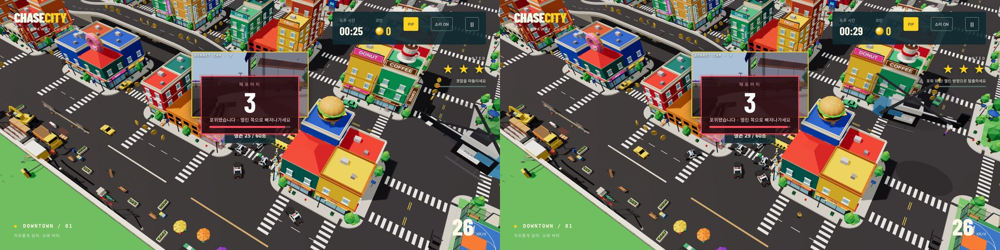
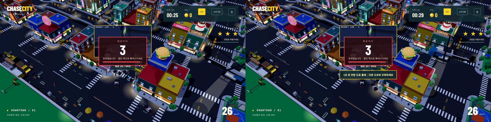
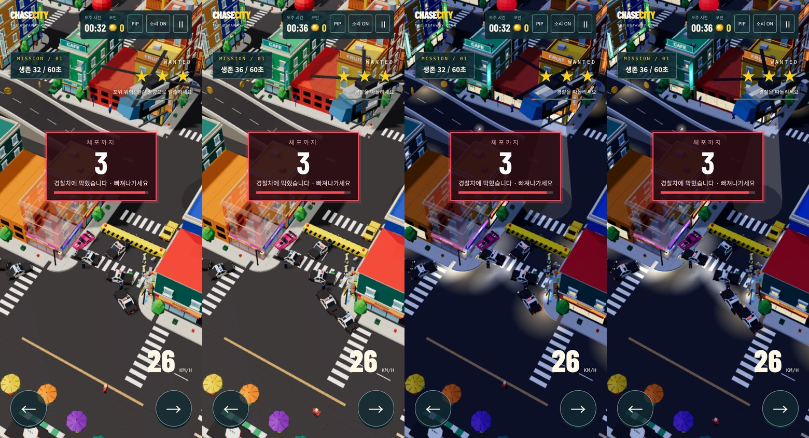
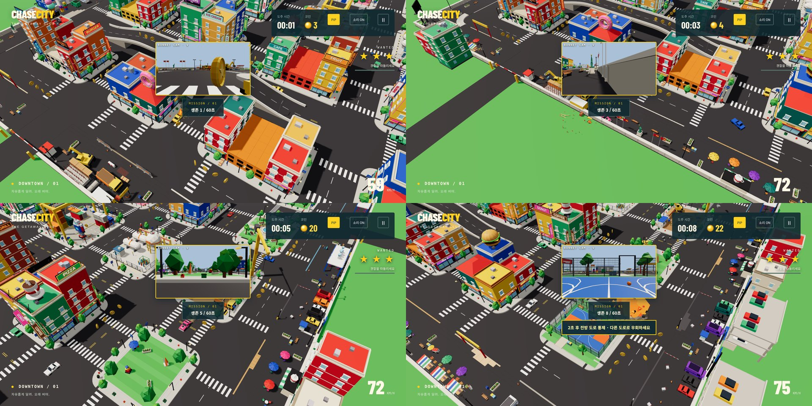
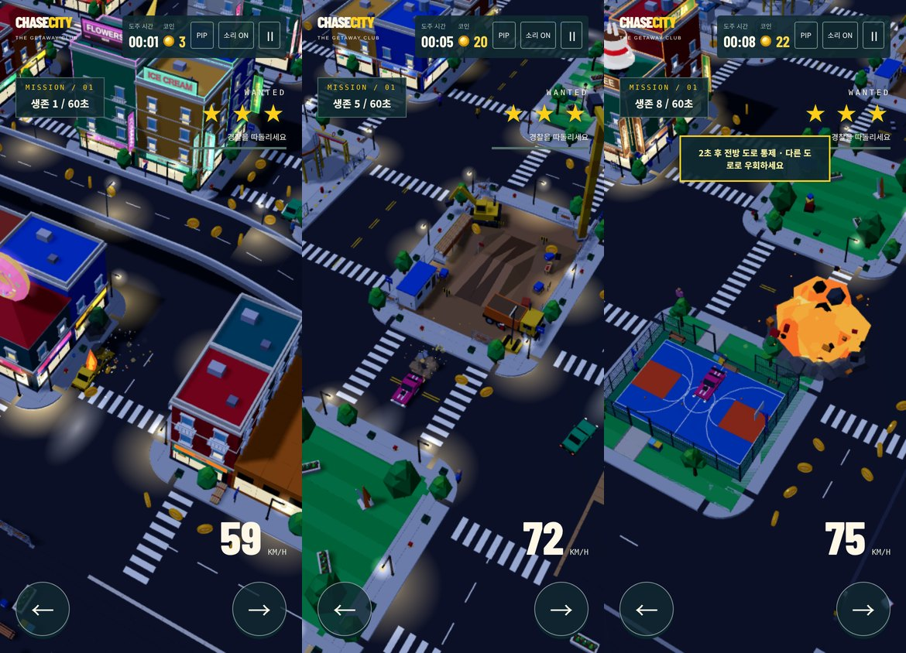

# CHASE CITY — 경찰 헬리콥터 · 코인 수집 보고서

- 브랜치: `claude/v20-mission-platform` (main 미병합)
- 작업 전 체크포인트: `aa0963e` (로컬 태그 `checkpoint-heli-coins`)
- 커밋:
  - `926eadb` 0단계: 플레이어 차량 내구도 비활성화
  - `dd1ce7c` 1단계: 경찰 헬리콥터
  - `050fdb4` 2단계: 코인
  - `031e722` 3단계: 밸런스
  - 이 문서 커밋
- 개발용 시드: **`?seed=3`** (개발 빌드). 헬리콥터 추격, 코인(도로·골목·고가도로 위·점프대 공중·시설), 공사장 점프대, 주요 파괴 시설이 모두 있습니다.

## 0. 시작 전 확인 사항

작업 전 브랜치를 확인한 결과, 이전 작업 결과(교량, 점프, 민간 차량 화재, 간판·네온, 낮·밤)는 모두 남아 있었습니다. 다만 **플레이어 차량 내구도 게이지와 '내구도 소진' 게임 오버가 아직 활성 상태**였습니다. 요구사항에 맞게 먼저 비활성화했습니다.

- 플레이어 차량 체력은 항상 100%이고 게이지가 없습니다. 충돌 횟수만 집계합니다.
- 어떤 미션도 'destroyed'로 실패하거나 이어하기를 하지 않습니다.
- NPC 차량(경찰·민간)은 그대로 파괴됩니다.

## 1. 경찰 헬리콥터 구현

- **모델**: 흑백 경찰 도장, 둥근 조종석과 푸른 유리, 양쪽 문과 지붕의 POLICE 글자, 꼬리 붐·수직 꼬리날개·스키드, 기수 아래 서치라이트, 빨강·파랑 경광등과 흰 스트로브, 회전하는 주 로터(블레이드+잔상 원판)와 꼬리 로터.
- **크기와 경량화**: 자동차보다 크게 보이도록 1.35배로 그립니다. 본체는 메쉬 1개, 실시간 광원은 없습니다.
- **비행**:
  - 속도를 목표 위치로 부드럽게 조향합니다(최대 가속 제한). 진행 방향으로 기수를 돌리고, 회전할 때 기울며, 고도는 약 21 m입니다.
  - 건물과 충돌하지 않고 플레이어와도 물리 충돌이 없습니다.
- **화면 배치(가독성 우선)**:
  - 고도 때문에 화면 위쪽으로 보이는 효과까지 계산해, 헬기가 화면 가장자리에 오도록 위치를 정합니다. 넓은 화면에서는 좌·우 측면, 세로 휴대폰에서는 위쪽 측면입니다.
  - 차가 헬기 쪽으로 향하면 화면 위쪽을 돌아 반대편으로 옮겨갑니다.
  - 화면상 차와 18 m 이내로 겹치려 하면 즉시 바깥으로 비킵니다.
  - 그래도 헬기의 화면 윤곽이 차나 진행 방향 앞 도로(8·16 m)를 가리면 22% 투명도로 흐려집니다.
  - 게임 카메라는 바꾸지 않았습니다.
- **낮**: 태양 방향으로 바닥에 부드러운 그림자가 따라다닙니다. 로터 회전과 경광등도 보입니다.
- **밤**: 바닥에 원형 서치라이트(반투명 가산 합성)와 옅은 빛줄기가 생깁니다. 차를 약간 늦게(급회전 시 지연) 따라갑니다. 도로·차·코인을 가리지 않는 밝기입니다.
- **소리**: 로터 '두두두' 소리(저역 노이즈 + 11.5 Hz 맥동)가 거리에 따라 커집니다. 헬기가 처음 나타날 때 만들어집니다.

## 2. 출현·추격 조건

- 경찰이 있는 미션에서만 나옵니다. 경찰이 없는 미션(택배, 타깃 헌트)에는 나오지 않습니다(테스트로 확인).
- 추격 18초 후(설정값)에 1대만 출현합니다. 화면 왼쪽 위 바깥 약 150 m에서 날아오며, 플레이어 바로 위에 갑자기 나타나지 않습니다.
- 20~34초마다 화면 위쪽을 가로지르는 비행을 합니다. 미션이 끝나면 떠납니다.
- **추적 중 경찰 협력**(제한적):
  - 경찰차 3대부터 양옆 측면 차단을 시작합니다(기존 4대).
  - 전방 차단이 늦게 시작되는 일이 없습니다.
  - 체포 조건과 증원 출현 규칙(화면 밖)은 바꾸지 않았습니다.
  - 미사일·사격·직접 공격·플레이어 피해·즉시 체포는 없습니다.
- **공정성 확인**(같은 시드·같은 운전자, 24회씩, Node 시뮬레이션):

| | 헬기 있음 | 헬기 없음 |
|---|---|---|
| 체포 | 22회 | 23회 |
| 평균 생존 | 33.8초 | 32.9초 |

  헬기 때문에 체포가 쉬워지지 않았습니다.

## 3. 스크린샷

| | |
|---|---|
| 낮: 헬기(화면 오른쪽 가장자리)와 바닥 그림자 |  |
| 밤: 서치라이트 |  |
| 휴대폰 세로(390×844) 낮·밤: 헬기는 위쪽 측면, 밤에는 차 위 서치라이트 |  |
| 코인: 도로 줄 → 수집 → 점프 공중 코인 → 경찰차 파괴 보상(PC 낮) |  |
| 코인: 휴대폰 밤 |  |

(스크린샷은 실제 게임 루프 화면입니다. 테스트 스크립트가 체포를 막기 위해 포위 카운트다운을 계속 초기화해서, 일부 화면에 카운트다운 표시가 보입니다.)

## 4. 코인 배치·수집

- **모양**: 두께가 있는 금화(테두리, 양면에 돋을새김 별)입니다. 계속 회전하고 위아래로 떠 있으며, 가끔 반짝입니다. 밤에는 약간 자체 발광합니다. 인스턴스 메쉬 1개로 그리고, 플레이어 주변 85 m 안의 코인만 그립니다.
- **배치**: 시드마다 결정적이며, 도시당 약 118개입니다.
  - 일반 도로: 한 차선에 4개씩 3 m 간격 짧은 줄, 20곳(각 1코인). 도시 전체를 잇는 줄은 없습니다.
  - 골목·위험 경로(각 2코인):
    - 골목 길이 14 m마다 한 그룹(5개).
    - 고가도로 상판 위 3그룹. 상판 위에서만 먹을 수 있고, 아래 도로에서는 먹을 수 없습니다.
  - 공사장 점프대(각 2코인): 실제 점프 물리로 계산한 비행 궤적(22 m/s)을 따라 공중 코인 6~7개, 작은 흙더미 위 각 1개.
  - 시설(각 2코인): 컨테이너 야적장·놀이공원·레스토랑 광장 통로, 주유소·가스 저장소 앞.
  - 고체(건물·시설) 안이나 지도 밖에는 놓지 않습니다(20개 시드 테스트).
- **수집**:
  - 플레이어 차가 2.6 m 안으로 지나가면 자동으로 수집합니다(공중 코인은 높이 3.2 m 범위).
  - 코인이 차로 빨려 들어가며 작아지고 반짝임이 생깁니다. 두 음 차임 소리가 나고, 연속 수집 시 소리가 겹치지 않게 70 ms 간격을 둡니다. HUD 숫자는 즉시 올라가며 살짝 커졌다 돌아옵니다.
  - 코인은 물리적으로 막지 않습니다.
  - 경찰·민간 차량은 수집하지 않습니다. 한 번 수집한 코인은 같은 판에서 다시 나오지 않습니다.
- **HUD**: 기존 상단 패널의 내구도 게이지 자리에 '코인 + 금화 아이콘 + 이번 판 수'만 작게 표시합니다.

## 5. 파괴 보상 규칙

| 사건 | 코인 |
|---|---|
| 경찰차 폭발 | 2 |
| 민간 차량 폭발(불타서 터지는 차만, 모든 파손이 아님) | 1 |
| 주유기 섬 폭발 | 10 |
| 가스 저장소 탱크 파열 | 8 |
| 고가도로 구간 붕괴 | 12 |
| 대형 광고 조형물 낙하 | 3 |
| 랜드마크 파괴 | 6 |
| 대관람차 이탈 | 6 |
| 불꽃놀이 가게 | 5 |
| 연쇄 폭발 단계 | +1/단계(판당 최대 6) |

- 같은 물체는 한 번만 보상합니다(물체별 키).
- 파괴 보상은 판당 최대 40코인입니다. 연쇄 반응으로 무한히 늘지 않습니다.
- 보상이 생기면 잔해에서 코인 몇 개가 튀어 올라 차로 날아옵니다.
- 모든 값은 `src/game/coins.js`의 설정 하나에 모여 있습니다.
- **획득 가능 코인 비율**(10개 시드 평균): 도로 38%, 골목·위험 경로 21%, 점프대·특수 위치 22%, 파괴 20%(판당 상한 기준). 요청한 초기 비율 40/25/15/20에 가깝습니다.

## 6. 저장·보상 처리

- 기존 '크레딧' 시스템(localStorage, 판별 중복 지급 방지)이 이미 있어서, 새 화폐를 만들지 않고 **코인으로 통합**했습니다. 화면의 '크레딧' 표기는 모두 '코인'으로 바꿨습니다. 미션 보상도 코인입니다. 회사의 실제 리워드 포인트와는 완전히 분리된 게임 내 화폐입니다.
- 미션이 끝나면 성공이든 실패든 그 판의 코인을 저장된 잔액에 더합니다. 결과에는 '+N 코인 (주행·파괴 M)'으로 표시합니다.
- **중복 방지**:
  - 판마다 한 번만 지급합니다(판 키). 결과 화면을 다시 열어도 다시 지급하지 않습니다.
  - 이어하기 후에는 새로 모은 부분만 지급합니다.
  - 재시작하면 0부터 시작하고 코인이 새로 배치됩니다. 같은 판 안에서 코인이 다시 생기지 않습니다.
- 실제 게임 확인: 코인 4개 수집 후 체포(실패) → 저장 4 → 페이지 새로고침 후 잔액 4가 유지됐습니다.
- 차량 상점은 구현하지 않았습니다.

## 7. 회귀 테스트

- `npm test`: **216/216 통과**. 새 테스트는 다음을 확인합니다:
  - 헬기: 경찰 미션에서만 출현, 출현 시각, 원거리 진입, 화면상 차 위 표시 5% 이하, 추적.
  - 코인: 20개 시드 배치, 자동 수집·경찰 미수집, 공중 코인 점프 수집, 파괴 보상 1회·상한, 저장 1회·새로고침 유지.
  - 플레이어 내구도: 무적이며 'destroyed'가 없음.
- 브라우저(실제 게임 루프, 시드 1~3):
  - 상점 파손, 가스 저장소 탱크 3/3, 주차장 연쇄 폭발, 파괴 유지, 콘솔 오류 0.
  - 주유소 펌프는 시드 2·3에서 자동 카운터로 통과했습니다. 시드 1은 이전 보고서와 같은 계측 누락입니다(폭발은 화면으로 확인).
  - 교량: 1회 충돌로 기둥 파괴, 해당 구간만 붕괴, 재통과 성공.
  - 점프: 플레이어 18.9~22.3 m, 반대 방향, 경찰 점프 모두 성공.
- 장시간 주행(Node, 16회·24분):
  - 체포 38회, 오체포 0회, 4초 이상 정체 37회(최장 11.1초).
  - 직전 빌드는 체포 29회, 오체포 1회, 정체 50회였습니다.
  - 체포가 늘어난 주된 이유는, 예전에는 '내구도 소진'으로 먼저 끝나던 판이 이제 끝까지 이어지기 때문입니다. 헬기 유무 비교(2절)에서는 차이가 없었습니다.
- 휴대폰 조작(좌우 버튼)은 바꾸지 않았습니다. 390×844 화면에서 헬기·서치라이트·코인 HUD를 확인했습니다.

## 8. 성능

Chromium SwiftShader(소프트웨어 렌더러), iPhone 13 에뮬레이션과 1280×720에서 측정했습니다. 시드 3, 헬기 진입 중 상태입니다. 실기기에서는 측정하지 않았습니다.

| 프레임 시간 중앙값 | 작업 전 aa0963e | 이번 빌드 |
|---|---|---|
| 휴대폰 밤 주행 | 283 ms | 293 ms |
| 휴대폰 밤 경찰차 4대 폭발 | 261 ms | 276 ms |
| PC 밤 주행 | 652 ms | 710 ms |
| 휴대폰 낮 주행 | 362 ms | 290 ms |

- 낮 측정은 측정 간 편차가 커서 이번 빌드가 오히려 빠르게 나왔습니다. 밤 기준으로 약 3~9% 느려졌습니다.
- 드로우콜은 헬기·코인으로 약 +10개 늘었습니다.
- 코인은 인스턴스 메쉬, 파티클은 풀로 처리하고, 헬기에는 실시간 광원을 쓰지 않습니다.

## 9. 남은 문제

- 실기기 성능을 측정하지 않았습니다.
- 넓은 화면에서 헬기는 측면 가장자리에 있어, 진입 중에는 대부분 화면 밖에서 접근합니다. 진입 전체가 보이지는 않고, 정위치 도착 직전부터 보입니다.
- 급회전하면 헬기가 잠시(테스트 기준 비행 시간의 5% 이하) 차 근처로 보일 수 있습니다. 이때는 반투명해집니다.
- 자동 운전 봇은 코인을 노리지 않아, 실측 획득에서는 파괴 비중이 높게 나왔습니다(봇 기준 약 70%). 실제 플레이어 기준 밸런스는 플레이 테스트 후 조정이 필요합니다.
- 페이지를 판 도중에 닫으면 그 판의 코인은 저장되지 않습니다(미션 종료 시 지급).

## 10. 미리보기

- 게임: https://claude.ai/artifact/RDq46DwiMjLpsBFeNn7SPL (버전 17, `031e722` 빌드). 비공개이므로 공유 메뉴에서 공유해야 다른 사람이 열 수 있습니다.
