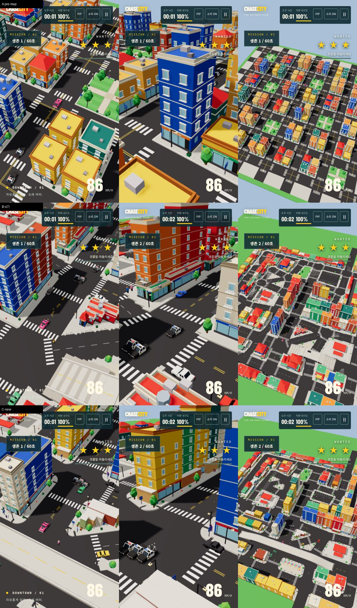
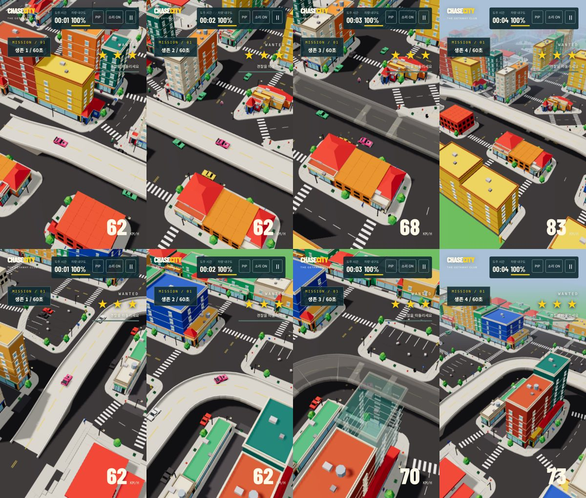
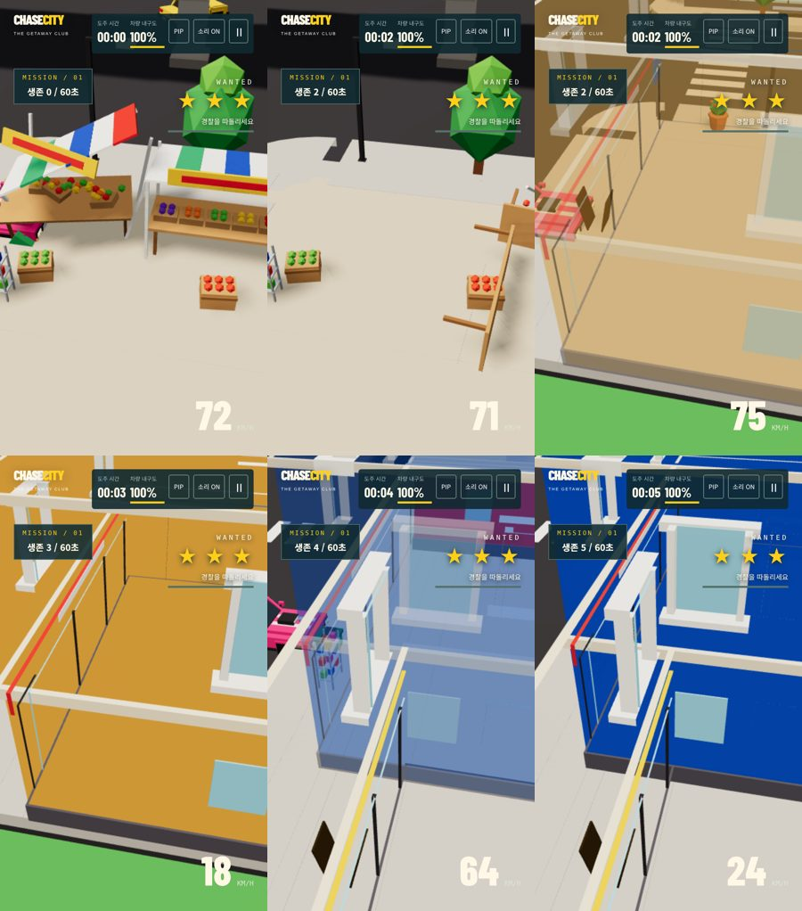

# CHASE CITY V2.2 — 맵 품질 복구 · 고가도로 재설계

브랜치: `claude/v20-mission-platform` (main 미병합)
커밋: `f1ceea2` → `9e3de52` → `c5f75fa`
비교 기준: 랜덤 맵 개편 직전 커밋 `6bf8cb3`(고정 다운타운). `git worktree`로 따로 띄워 같은 카메라 각도로 촬영했습니다.

## 1. 퇴보 원인 (코드 비교)

| 항목 | 6bf8cb3 (개편 전) | V2.1 (회귀) | 원인 |
|---|---|---|---|
| 상호작용 소품 | 654개 | 196–208개 | `citygen.placeStreetProps` 간격 8–13 m, 교차로 제외 반경 11 m |
| 가구(가판대·카페 세트·간판 등) | 프리뷰에서만 작동 | 본 게임 0개 | FlyerSystem이 본 게임 렌더러에 연결되지 않음 |
| 인도 경계 | 직선 격자 | 계단 모양 | 래스터 셀(2 m) 단위로 인도와 연석을 그림 |
| 횡단보도 | 교차로마다 | 램프·중복 위치에도 생성 | 교차로 차수·램프·기둥 검사 없음 |
| 고가도로 | — | 짧은 1블록, 급경사 | 반경 12 m 램프, 직선 1구간 |
| 바리케이드 | 건물에서 건물까지 | 빈 땅 옆에 틈 | 폭을 고정값으로 계산 |

## 2. 복구·수정 내용

### P0 파괴 밀도
- 거리 소품: 도시당 **470–490개**. 가로등, 쓰레기통, 나무, 표지판, 소화전이 순환 배치됩니다.
  - 간격 3.6–4.8 m, 교차로 제외 반경은 도로 폭/2 + 4.5 m로 줄였습니다.
- 가구: 도시당 **150–220개**. 기존 FlyerSystem을 본 게임에 연결했습니다(`render/furniture.js`).
  - 상점 앞: 입간판, 진열대
  - 교차로 모서리
  - 시장: 가판대 열, 상자, 카트
  - 광장과 공원: 카페 세트
  - 주차장: 카트, 정산기
  - 주유소: 가스통
  - 도로 공사 현장 1곳
- 합계 **630–700개**로 개편 전(654) 수준입니다. 종류는 15종 이상입니다.
- 소화전 물줄기, 폭발 연쇄(`blastListeners`), 잔해 유지는 기존 시스템을 그대로 씁니다.
- 시장 부지(래스터 PLAZA 코드)를 새로 두어 8개 도시 중 7개 이상에 생성됩니다.

### P1 고가도로
- 길이 **80 m 이상**(교차로 2–3개를 지남)입니다.
- 램프 28 m에 smoothstep 높이 곡선을 써서 최대 경사가 17° 미만입니다. 데크 높이는 5.2 m입니다.
- 직선형과 곡선형(교차로에서 반경 16 m 사분원)이 있습니다.
- 데크 아래 18 m 대로의 양쪽 차선으로 지상 통행이 가능합니다. 기둥은 중앙분리대에만, 교차 도로 밖에 둡니다.
- 2층 충돌은 경로 투영 방식(`overpassLocal`)입니다. 양쪽 끝 어디서든 진입할 수 있고, 난간은 국소 법선 방향으로 밀어냅니다.
- 내비게이션 노드에 층을 구분했습니다. 경찰은 플레이어가 데크 위에 있을 때만 램프에 오릅니다.
- 플레이어가 데크 아래에 있으면 데크가 반투명(불투명도 0.32)해집니다.
- 이번 단계에서는 붕괴하지 않습니다(`destructible:false`).
- 지상 경로의 차량, 경찰, 타깃은 램프에 오르지 않고 옆 차선으로 갑니다(`noRamp`).

### P2 도로·인도 기하
- 인도 띠는 도로 폴리라인을 오프셋해 만듭니다(폭 2.9 m).
- 교차로 모서리 원호는 실제 연석선의 교점에서 계산합니다.
- 도시 바닥은 아스팔트이고, 래스터 채움은 연석에서 1.6 m 이상 떨어진 셀에만 씁니다. 그래서 계단 모양이 사라졌습니다.

### P3 횡단보도
- 3갈래 이상, 램프 발치가 아닌 교차로에만 둡니다.
- 램프(높이 4.5 m 미만 구간) 위와 기둥 근처는 제외합니다.
- 3 m 이내 중복을 제거하고, 도로 방향에 맞춥니다.

### P4 레이아웃
- 바리케이드 폭을 양쪽 건물까지 0.25 m 단위로 측정합니다. 한쪽이 빈 땅(14 m 이상)이면 그 후보를 쓰지 않아 우회 틈이 없습니다.
- 대형 주차장은 700 m² 이하로 제한했습니다.
- 시드로 재현할 수 있고, 미션 중에는 재생성하지 않습니다.

### P5 회귀 방지
- 조작은 자동 전진에 좌우 조향만 있습니다(후진·브레이크 없음).
- 차량 질량에 따른 밀어내기를 유지하고, 내구도를 반영합니다.
- 타깃 헌트 타깃이 고가도로에서 멈추던 문제를 고쳤습니다.
  - 원인: 지상 경로인데도 램프에 올라 난간에 걸림
  - 결과: 16회 중 9회 → 0회

## 3. 테스트

- `npm test` **197/197 통과**
  - 신규 `tests/overpass.test.js`(6): 길이와 경사, 직선·곡선 주행(조향만), 지상 옆 차선, 경찰의 데크 추적, 기둥 위치, 붕괴 없음
  - 신규 `tests/mapquality.test.js`(6): 밀도, 가구 위치, 횡단보도, 인도 겹침 2 % 미만(측정 0.79 %), 바리케이드 밀폐, 질량
- 생성 도시 소크 테스트(16회, 18.7분): 최장 고착 9초(V2.1은 23.9초), 체포 38회
- 끼임 스윕(시드 3, 5, 7): 0회
- 타깃 헌트 고착 검사(16회): 0회
- 미션 스모크(생존, 택배, 타깃 헌트 × 3 시드): 오류 없음. 타깃이 고체 안에 있던 프레임은 724 → 0입니다.
- 브라우저 스모크(빌드본 2종): 콘솔 오류 없음, 음악과 타이머 정상

### 성능 (SwiftShader 소프트웨어 렌더, 상대값)

| | 6bf8cb3 | V2.2 |
|---|---|---|
| 폰 프레임 중앙값 | 153 ms | 206 ms |
| 삼각형 | 78k | 102k |
| 드로우콜 | 82 | 71 |

## 4. 스크린샷 (같은 시드·카메라: 추격 / 거리 / 전경)

A = 6bf8cb3, B = V2.1, C = V2.2

고가도로 (위: 직선형, 아래: 곡선형; 램프 → 데크 → 아래 반투명 → 전경)

가구

## 5. 남은 문제
- 실제 iOS/Android 기기에서는 테스트하지 않았습니다.
- 예각 5갈래 교차로에서 인도 띠가 일부 겹칩니다(0.79 %).
- 소프트웨어 렌더 기준 개편 전보다 약 35 % 느립니다(소품과 가구 증가분). 실기기 측정이 필요합니다.
- 생성 맵에서는 바리케이드 후보가 엄격해 로드블록이 드물게 나옵니다.
- 소크 테스트에서 오체포 1회가 있었습니다(고착 판정 프로브의 한계).
